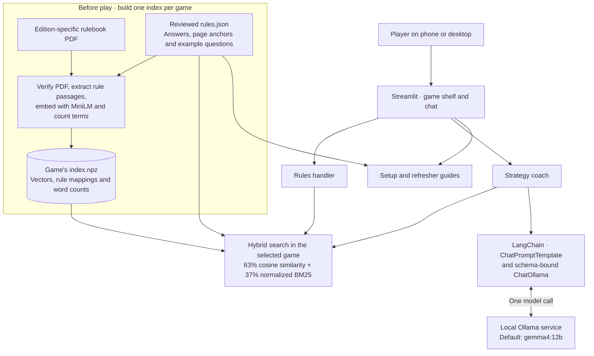
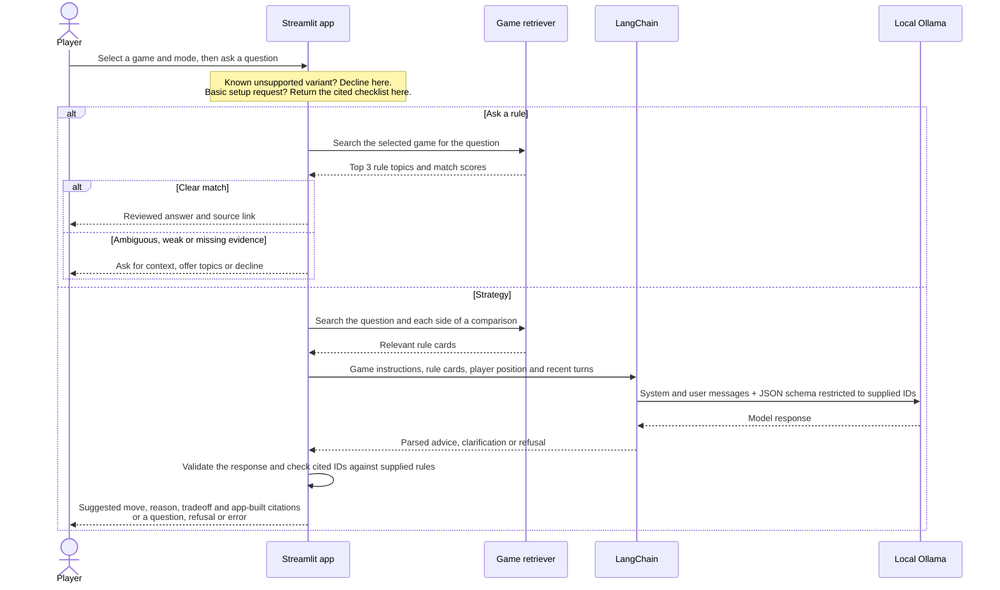

# How Tabletalk answers a question

The player picks a game and a mode. **Ask a rule** finds a reviewed answer and shows its source. **Strategy** uses retrieval-augmented generation (RAG): it retrieves rules from the same game, gives them to a local language model along with the player's position, and asks it to recommend a move.

## 1. Architecture

CATAN and Pandemic have separate catalogs and indexes; both use the same MiniLM encoder. The app searches local files, so it doesn't fetch or re-embed the rulebook on each question. The catalog provides the source links, including CATAN's publisher catalog for its player-count entry. Chat history is separate for each game and for rules versus strategy.

## 2. What happens in chat

**What gets retrieved?** For rules, the app scores each topic using its best MiniLM cosine match and its normalized BM25 keyword score. For strategy, the app starts with four topics for the whole question and adds two per side of an explicit comparison. It also includes relevant prior evidence, game-specific core rules, and up to two recent strategy turns. The LLM receives reviewed rule text and IDs. It does not search the PDF or supply citation URLs.

**What does validation guarantee?** An advice response must name sources that were actually in the prompt. The app constructs the links from its catalog. That verifies which rules were cited; it does not prove the recommended move is optimal or that every generated sentence follows from those rules. If the model is unavailable or its references fail validation, the app shows an error. Rules and guides still work.

## The same Pandemic position, two different jobs

| Mode | Player asks | Where the answer comes from |
| --- | --- | --- |
| Ask a rule | “How many cards does the Scientist need for a cure?” | The app returns the reviewed Scientist rule: four City cards of one color at a research station. It links to the role on p. 8 and the cure action on p. 4. No LLM call. |
| Strategy | “I'm the Scientist at a station with four blue cards. Blue is the only uncured disease. Should I treat or cure?” | The coach can use the Scientist, cure and victory rules to recommend discovering the cure now: the fourth cure ends the game immediately. The recommendation is generated; the linked mechanics come from the rulebook. |

Implementation: [index builder](../tabletalk/ingestion/build.py) · [hybrid search](../tabletalk/retrieval/index.py) · [rules handler](../tabletalk/answering/agent.py) · [strategy coach](../tabletalk/strategy/coach.py) · [local model client](../tabletalk/strategy/ollama.py).
